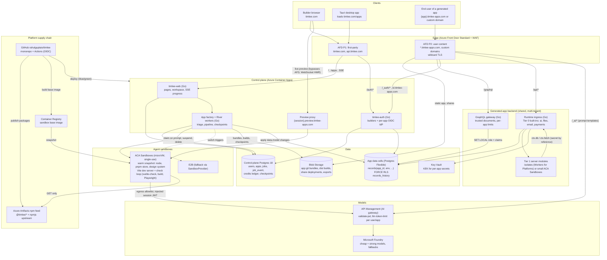

# Timlee on Azure: cloud architecture

_Status: recommendation, not yet built. Researched 2026-11-04 by 27 research
agents across three rounds: (1) sandboxes, competitors, workspace and
hosting, agent licensing and security, platform cost, temporary hosting;
(2) monorepo, Front Door and URLs, deployment, GraphQL, app databases,
control database, auth, real-time and API edge, data security, build-vs-buy,
per-app server runtime; (3) validation against Lovable, Bolt, v0/Vercel,
Replit, GitHub Spark, Cloudflare VibeSDK, Google AI Studio/Firebase,
Base44 and peers, sandbox providers, and hosted coding agents (§13). Prices
are list prices (East US / East US 2, USD) unless noted. Anything marked
**(unverified)** must be checked before committing._

The local POC (this repository plus `workspace/` on one laptop) stays as it
is until cloud work starts. This document is the target.

---

## 1. Decisions at a glance

| Area | Decision |
|---|---|
| Cost principle | **No app ever owns a machine.** An idle app is files in Blob Storage and rows in a shared database: about $0.0003–0.002 per app per month. Compute runs only while someone is editing or a request is being served. |
| Biggest cost | **Model tokens: 85–95% of the bill.** Optimise routing, caching and per-user budgets before compute. |
| Monorepo | Merge the platform parts of `workspace/` into the GitHub `timlee` repo. Each generated app becomes its **own git repo stored as bundles in Blob**. |
| Agent sandboxes | **Azure Container Apps Sandboxes** (preview; the same fabric as GitHub Copilot's cloud sandboxes): single-use microVMs from a shared snapshot, claimed only when a prompt is sent, suspended by the control plane when idle, deny-by-default egress in **Full** inspection with credential injection. Behind a **`SandboxProvider` interface** with E2B as a tested fallback. |
| Agent and models | POC: the founder's Copilot CLI. Before external users: **Copilot SDK in bring-your-own-key mode against Microsoft Foundry**, metered by **API Management (Basic v2)**. Later the agent loop moves to the control plane and the sandbox only executes tools. |
| Generation pipeline | **Triage → (plan) → cached context pack → diff edits → deterministic fixers → check-and-repair loop (type check, lint, build, headless browser) → gates → commit** (§5.1). Competitors show this, not a better model, drives first-try success and token cost. |
| Domains | `timlee.com` (website), `timlee-apps.com` (all user content, on the Public Suffix List). |
| Edge | **Two Azure Front Door Standard profiles** (first-party, user content). Live previews **bypass** Front Door. |
| Control plane | Go services on **Container Apps**; **PostgreSQL 18 Flexible Server** + **River** job queue + **goose** migrations. |
| Generated apps' data | **Pooled Postgres "cells"**: shared tables keyed by `app_id`, JSONB documents, forced row-level security. Busy apps graduate to their own schema or server. |
| Generated apps' API | **One shared Go GraphQL gateway**, same-origin `/graphql` on each app's host; no CORS, no tokens in the browser. |
| Generated apps' auth | **Extend `timlee-auth` into a per-app identity provider** (`zitadel/oidc` Go library), BFF cookie flow, app identity from the Host header. |
| Generated apps' server code | **Tiered**: declarative by default (no code, plus built-in `ai`, `files`, `email`, `payments` capabilities); custom code on a **shared isolate runtime** (Azure-only: small ACA Sandboxes or ACA Express, benchmarked; cost-optimal: Cloudflare Workers for Platforms); a shared **WebAssembly fleet** later only if needed. One portable `server/` contract across all tiers. |
| Generated apps' AI | Same-origin **`/_ai/*`** through API Management with server-side prompt templates and per-end-user limits, billed to the app owner's **runtime** credits. |
| Checkpoints | Each prompt is a **checkpoint**: commit + data-model version + dev-data snapshot + conversation turn, with restore and roll-forward. |
| Billing | Separate **build** and **runtime** credit accounts; charge only successful generations; visible cost per message with a check-in threshold; free tier with hard daily caps. |
| Infrastructure as code | **Bicep** + GitHub Actions with OIDC; two subscriptions (nonprod, prod); blue/green Container Apps revisions. |
| Base-case cost (10k apps, 500 daily builders) | ≈ **$3–3.5k/month infrastructure + $7–15k model tokens** after the generation pipeline (§10). |

### 1.1 Architecture diagram

Solid arrows are request or data paths; the dotted arrow is the sandbox fallback.



---

## 2. Licensing (before external users)

The local POC runs prompts through the founder's own Copilot account for the
founder's own testing. That is fine. It must change before anyone else can
submit prompts: Copilot seats are licensed per user, so serving other
people's prompts through one seat is not permitted (GitHub Terms for
Additional Products and Features; seat assignment docs).

- **Compliant path:** the GitHub **Copilot SDK in BYOK mode**, which accepts
  Microsoft Foundry / Azure OpenAI endpoints with managed identity and needs
  no Copilot subscription (<https://github.com/github/copilot-sdk>), or the
  OpenAI/Anthropic SDKs, against Timlee's own Foundry deployments.
- Do not use Copilot seats or the Claude Code binary as a shared backend.
  Get written confirmation from GitHub before relying on any org-billed
  Copilot mode for external customers.
- GitHub Models was retired on 2026-07-30; Foundry replaces it.

---

## 3. Where everything lives

### 3.1 Repositories

```
GitHub: rahulguptaio/timlee  (platform monorepo; Bazel + Go + pnpm)
 ├─ cmd/, internal/            website, auth, app factory, gateway, runtime ingress
 ├─ web/                        website templates, assets, components
 ├─ desktop/                    Tauri shell for the website
 ├─ workspace/                  ← merged in from today's separate repo, minus apps/
 │   ├─ packages/design         @timlee/design   (semver, published)
 │   ├─ packages/graphql        @timlee/graphql  (semver, published)
 │   ├─ packages/server-sdk     @timlee/server   (server-module SDK, new)
 │   ├─ packages/desktop        Tauri shell for generated apps
 │   ├─ templates/app           app template (tagged per release)
 │   └─ tools/                  Bazel rules, desktop packaging, fetch proxy
 └─ infra/                      Bicep (see §9)

Azure Blob: apps/{appId}/repo/…  one git repo per generated app (bundles)
```

- **Why merge the platform parts:** one commit can change the agent prompts,
  Go orchestration and the template or design system together; one CI; one
  `AGENTS.md`. Use CI path filters so Go changes don't rebuild JS.
- **Before apps leave the monorepo**, `@timlee/design` and `@timlee/graphql`
  need real version numbers (today they are `workspace:*`).
- **Stay on GitHub + GitHub Actions** (Linux runners $0.006/min after the
  2026-01-01 price cut), authenticating to Azure with OIDC. Azure Repos and
  Azure Pipelines add nothing at this scale.

### 3.2 Per-app code storage

| Option | Verdict |
|---|---|
| **Git bundles in Blob** (`apps/{appId}/{sha}.bundle` or one incremental bundle per prompt; head ref in Postgres; versioning on; old bundles to Cool) | **Recommended.** No per-repo limits, ≈ $0.02/GB-month, ACLs in our own database, nothing to run. |
| GitHub org + GitHub App | Breaks at 10×: 100,000 repos per org (since 2025-04-28) and ≈ 80 content creations/min, 500/hour. Keep GitHub only for **user export** ("push to my GitHub" via a GitHub App user token). |
| Azure Repos | Needs Entra/Azure DevOps identities; doesn't fit consumer users. |
| Forgejo/Gitea on Container Apps | Only if users ask for a hosted git UI; it is always-on compute. |

### 3.3 Packages and sandbox images

- CI publishes `@timlee/*` to an **Azure Artifacts npm feed** (2 GiB free,
  then from $2/GiB) with **npmjs as an upstream**, so sandboxes need only one
  allow-listed package host and are protected from npmjs outages.
- CI builds a **sandbox base image** (Node, pnpm, the template, a pnpm store
  pre-filled with every allowed package, the `@timlee/*` tarballs, the agent)
  → Azure Container Registry `base:<platformSha>` → a warmed sandbox
  snapshot, rolled out in stages.
  The image is rebuilt only when the template, design system or allowed
  dependencies change (Cursor skips unchanged environment builds), and it
  includes Playwright's headless browser for the check loop (§5.1).
- **Upgrades are lazy:** when a user next prompts on an app, the agent first
  bumps it to the current template/design versions, builds, and commits the
  bump only if the build passes. Only active apps pay for upgrades. A nightly
  bot handles security bumps in cohorts with automatic rollback.

### 3.4 Bazel's role

Bazel builds the **platform** (Go services, design system, template, tools)
in CI. It is **not** run per prompt: a plain Vite build of a template-sized
app takes seconds inside the sandbox and needs no remote cache.

---

## 4. Domains, URLs and the edge

### 4.1 Domain plan

| Domain | Purpose | Why |
|---|---|---|
| `timlee.com` | Website, sign-in, workspace, platform API | First-party. `__Host-` session cookie on the apex host only. HSTS preload. |
| `timlee-apps.com` | **Everything users or the agent create**: live previews, share links, published apps, end-user auth | A separate registrable domain keeps untrusted code away from `timlee.com` cookies and storage. **Add it to the Public Suffix List** (private section) so apps can't read or set each other's cookies either. |
| Customer domains | Published apps | CNAME to the user-content Front Door profile. Never send HSTS to customer domains. |

**Buy `timlee-apps.com` now and file the Public Suffix List PR on day one**:
it is a GitHub pull request plus a `_psl` TXT record, with no service-level
timeline (plan for weeks to months, then browser release lag).

### 4.2 URL map

| URL | Through | Origin | Auth |
|---|---|---|---|
| `https://timlee.com/` and pages | Front Door P1 | `timlee-web` (Container Apps) | `__Host-sid` cookie (Secure, HttpOnly, SameSite=Lax) |
| `https://timlee.com/auth/*` | Front Door P1 | `timlee-auth` | same cookie; OAuth callbacks `https://timlee.com/auth/callback/{provider}` |
| `https://timlee.com/apps/{slug}` | Front Door P1 | `timlee-web` (workspace: prompt, code, theme) | session + allowlist + **app ownership** |
| `https://timlee.com/apps/{slug}/jobs/{id}/events` (SSE) | Front Door P1, route with **no cache, no compression** | `timlee-web` | session; see §7.1 for timeouts |
| `https://api.timlee.com/` | Front Door P1 | platform API (later) | API keys / OAuth for server-to-server |
| `https://{session}.preview.timlee-apps.com` | **Direct to Container Apps** (bypasses Front Door) | preview proxy → the session's sandbox Vite dev server (WebSocket HMR) | capability token in the URL, exchanged for a host-only cookie |
| `https://{app}-{deployId}.timlee-apps.com` | Front Door P2 | Blob `sites/{hostname}/…` | the random `deployId` is the secret; optional password via the preview server |
| `https://{app}.timlee-apps.com/` | Front Door P2 | Blob (published static build) | none (public app) |
| `https://{app}.timlee-apps.com/graphql` | Front Door P2 | shared GraphQL gateway | end-user session cookie (BFF), CSRF header |
| `https://{app}.timlee-apps.com/_auth/*` | Front Door P2 | `timlee-auth` (per-app identity provider) | sets the app's own `__Host-` cookie |
| `https://{app}.timlee-apps.com/api/*` | Front Door P2 | server-module runtime ingress (§6.4) | end-user session or the app's server key |
| `https://{app}.timlee-apps.com/_ai/*` | Front Door P2 | API Management → Foundry (§6.7) | end-user session; per-end-user and per-app token limits; prompt templates only |
| `https://id.timlee-apps.com/` | Front Door P2 | `timlee-auth` | central social-login callback; per-app OIDC issuers `/a/{appId}` |
| Customer domain `https://shop.example.com/…` | Front Door P2 | same as `{app}.timlee-apps.com` | same |
| Desktop (Tauri) | — | loads `https://timlee.com/apps` | sign-in in the **system browser** (loopback + PKCE, already implemented), never an embedded webview |

Same-origin `/graphql`, `/_auth/*` and `/api/*` on every app host mean **no
CORS and no tokens in the browser** (the IETF browser-based-apps guidance puts
the backend-for-frontend pattern first).

Local POC equivalents: website `http://localhost:5173`, auth
`http://127.0.0.1:8788`, previews `http://preview.localhost:5174/<capability>/<slug>/`.

### 4.3 Front Door

| Fact (verified) | Standard | Premium |
|---|---|---|
| Base fee | $35/month | $330/month |
| Requests (Zone 1, per 10k) | $0.009 | ≈ $0.012 **(unverified)** |
| Egress to clients (first 10 TB) | $0.083/GB | same |
| Custom domains / routes / rule sets per profile | 100 / 100 / 100 | 500 / 200 / 200 |
| Private Link to origins, managed WAF rules, bot protection | no | yes |

- **Two Standard profiles:** P1 for `timlee.com` and `api.timlee.com`; P2
  for `*.timlee-apps.com` and customer domains. ≈ **$160/month** at 500 GB
  egress and 50M requests.
- **Wildcard managed certificates** are GA (June 2025). A wildcard domain
  can't be cache-purged as a whole; purge the specific subdomain on publish.
  Apex domains need a fresh TXT validation at each certificate renewal.
- **Composite route limit:** 5,000 per profile (domains × paths). Customer
  domains will need more P2 profiles as they pass ~100 per Standard profile
  (up to 500 profiles per subscription).
- **Static routing:** one wildcard route on P2; a rule set rewrites
  `{hostname}/{path}` to the Blob folder for that hostname, falling back to
  `index.html` for client-side routes. Whether the rewrite accepts
  `{hostname}` is **(unverified)**; fallback is Front Door Edge Actions
  (preview, $0.10 per million) or a small Go router.
- **Origin lock-down without Premium:** Container Apps IP restrictions take
  IPv4 CIDRs only (no service tags), so allow the `AzureFrontDoor.Backend`
  ranges and have Go middleware check `X-Azure-FDID`. Upgrade only P1 to
  Premium when compliance requires Private Link (+$295/month plus ≈ $73 for
  the Container Apps environment private endpoint).
- **WebSockets** through Front Door are GA (2026-05-18), but close after 5
  minutes idle and 2 hours total, and must have caching off. That is why live
  previews bypass Front Door: long editing sessions would break, and the
  hundreds of module requests per Vite reload would all be billed.
- **SSE:** Microsoft's WebSocket page says "Front Door doesn't support
  Server-Sent Events". A community test (2026-04) shows short SSE streams
  pass through Premium with ≤ 0.4 s delay. Design for it (§7.1) and test it
  in CI.

### 4.4 Temporary deployments ("share for 24 hours / 7 days")

- One Blob container `sites`, one folder per deployment named after its
  hostname `{app}-{deployId}.timlee-apps.com`, where `deployId` is 128 random
  bits. Creating a deployment is an upload; Front Door needs no change.
- Expiry: a scheduled cleanup job deletes expired folders and purges the
  hostname; a Blob lifecycle rule (runs about daily) is the backstop.
- `index.html` gets a short cache time; hashed assets are immutable.
- Abuse: takedown endpoint, Google Web Risk checks before publishing, WAF.
- Not Azure Static Web Apps: 100 apps per subscription and 10 preview
  environments per app.
- Stopgap before `timlee-apps.com` exists: Firebase Hosting preview channels
  (built-in expiry up to 30 days) or Cloudflare Workers static assets.

---

## 5. How a prompt creates or edits an app

1. **Website** (`timlee-web`): checks the session, allowlist/plan, app
   ownership, the app's **code-freeze** flag and the build-credit balance.
   Shows the estimated cost. Inserts a `job` row and its River job in the
   same transaction and **reserves credits**.
2. **Triage** (cheap model, no sandbox): classifies the prompt as
   *no-model* (theme or text the editor can apply), *single-file* (cheap
   model), or *multi-file / new app* (strong model plus a short written
   plan). **Plan mode** and chat-only turns stop here: they read the app's
   bundle and never start a sandbox.
3. **New app:** the control plane creates the `app` row (owner org, slug,
   region, template version, design version) and its repo from a tagged
   template or a gallery fork, **with no model call** ("zero-token init").
4. **Sandbox:** only now claim a pre-warmed, **never-used** ACA Sandbox. Its
   snapshot already holds Node, pnpm, the pnpm store, the design system and
   the agent's tools. The app's repo (a few MB) is cloned in; `pnpm install
   --offline` takes about a second. If the app was edited in the last 24
   hours, resume its own suspended sandbox instead.
5. **Agent** works through the generation pipeline (§5.1) with **no
   secrets** in the sandbox (§5.2).
6. **Live preview** while editing: Vite dev server with HMR, reached only
   through the preview proxy on `{session}.preview.timlee-apps.com` with a
   short-lived signed token (§5.3).
7. **Progress** streams to the browser over SSE (§7.1) as structured events
   (plan, file changed, check passed/failed, screenshot, cost so far) so the
   UI shows a checklist, not raw logs. The run pauses for approval if it
   passes the user's check-in threshold (default 20 credits).
8. **Each prompt ends** with a **checkpoint** (§5.4). The platform applies any
   data-model change through the safe path (§6.2), builds a static preview of
   the commit, writes the bundle to Blob, and **settles credits** from
   measured tokens. Failed generations and platform-caused errors are
   refunded.
9. **Lifecycle:** the control plane, not the platform's idle detector,
   decides: no user input for 3 minutes (45 seconds once the in-browser
   preview of §5.3 exists) → close the HMR socket and suspend; 30 minutes or
   tab closed → final `vite build`, upload `dist/{sha}`, delete the sandbox,
   keep its suspended snapshot for 24 hours only. Hard caps: 10 minutes and
   25 agent turns per prompt, 4 hours per sandbox.

Job states: `queued → provisioning → running → checking → publishing →
succeeded`; any state can go to `failed` (retried while attempts remain) or
`cancelling → cancelled`; `timed_out` is a failure. Credits are reserved at
`queued` and settled or refunded at the end, with idempotency keys
`job:{id}:{phase}`.

### 5.1 Generation pipeline

v0 reports that raw model output fails in up to 10% of generations and that
its pipeline lifts the error-free rate from 65% (a frontier model alone) to
94% (Vercel's own benchmark). Cloudflare's VibeSDK, Lovable, Cursor and
GitHub's Copilot agent all converge on the same shape. Each step below is
cheaper than another model turn.

| Step | What it does | Model cost |
|---|---|---|
| **Context pack** | A fixed, versioned prefix: system prompt, `AGENTS.md`, a design-system component digest (Web Awesome tags, attributes, tokens), Svelte 5 rules, the app's data model and a repo map (file tree, exported symbols, routes). Chosen by intent from a small set of fixed blocks so the **prompt cache keeps hitting**. Knowledge files mined from past failures are added the same way. | Cached input ≈ 10× cheaper |
| **Edits as diffs** | `str_replace`-style edits; whole-file rewrites over a size limit are refused. Long chats keep the last turns plus a summary. | −20–30% input on long sessions |
| **Deterministic rewriter** | As output streams: fixes unknown Web Awesome tags/attributes to the nearest valid one (from the component manifest), rewrites Svelte 4 syntax to Svelte 5 (`export let` → `$props()`, `on:click` → `onclick`), fixes import paths. | none |
| **Deterministic fixers** | Missing imports, `package.json` scan against the allowed dependency list, ESLint/Biome `--fix`. | none |
| **Check-and-repair loop** | `svelte-check` / `tsc`, Biome, `vite build`, then a **headless Playwright load** that captures console errors and a screenshot. Failures go back to the **cheap model** with only the error diff, at most 2 rounds, then escalate once to the strong model. | ≈ 1–3k tokens per repair |
| **Critic** (multi-file changes only) | A cheap vision model checks the screenshot and diff against `AGENTS.md` (tokens, accessibility, no new dependencies). | < $0.01 |
| **Gates before commit** | Changed paths inside the app only; no `package.json`/lockfile changes; `gitleaks` on the diff; data-model validation. | none |

Track **first-try success** (build passes with zero repairs) and cost per
prompt for every route in an **eval harness**; it sets the routing
thresholds. A build that fails after the repair rounds is not committed and
its credits are refunded.

### 5.2 Sandbox security

- Egress policy in **`Full` inspection mode** (`Partial` lets non-HTTP traffic
  out), deny by default. Rules match host, path and method: **GET/HEAD only**
  on the Artifacts npm feed (blocks `npm publish` as an exfiltration path);
  **POST only** to the API Management model paths allowed for the user's
  plan, so a free-tier sandbox cannot reach the strong model at all.
- The `Transform` rule injects a **short-lived signed session JWT**; API
  Management validates it (`validate-jwt`) and keys `llm-token-limit` on the
  job and user claims, a per-job ceiling the agent cannot bypass.
- The sandbox never holds git credentials: the platform extracts the commit
  and checks paths. Bundle history is **platform-owned and append-only**
  (fast-forward only, Blob immutability).
- Alert on spikes of denied egress requests (Microsoft flags them as possible
  exfiltration attempts).
- **Later (phase 2):** run the Copilot SDK agent loop in the control plane
  and send only tool execution (files, shell, checks) into the sandbox, as
  Replit and Cloudflare now do. No model credentials ever enter the sandbox,
  and conversation state survives sandbox loss.

### 5.3 Previews

- The control plane mints a **5–15 minute signed token** scoped to one app,
  branch and sandbox, revocable by bumping a version counter. The preview
  proxy swaps it for a host-only cookie (`SameSite=None; Partitioned` for the
  iframe).
- Every checkpoint also gets a **static preview build**, so a shareable
  preview exists even after the sandbox is gone.
- **Phase 1.5, in-browser preview:** compile with the Svelte compiler and
  `@rollup/browser` (or esbuild-wasm) in a worker, served by a Service Worker
  on the preview host, with dependencies pre-bundled to ESM in Timlee's own
  Blob/CDN. The sandbox only streams file diffs. This cuts sandbox minutes
  35–60% ($400–650/month now, $4–6.5k at 10×) and works in Safari and Tauri
  (no `SharedArrayBuffer` needed, **unverified** in WKWebView). It requires
  locking the template (no custom Vite plugins) and a CI parity test against
  real Vite builds. The server Vite preview stays as the fallback. Do not buy
  WebContainers: Chromium-only in practice and a commercial licence.

### 5.4 Checkpoints and rollback

A checkpoint is a first-class record: `{git sha, data-model version,
dev-data snapshot, conversation turn, credits used}`. The UI offers restore,
**roll forward** and an opt-in "include data" choice (Replit's default is
code only). Dev data is small (≈ 20 MB), so it is snapshotted as a gzipped
`COPY` to Blob only when the prompt wrote data (≈ $1.5/month at the base
case). Conversation and agent memory live in the control plane so a restore
also restores context. A per-app **code freeze** is enforced by the platform
(it rejects commits and data-model changes), never by a prompt.

---

## 6. The backend for generated apps

### 6.1 Overview

```
Browser (generated Svelte app on {app}.timlee-apps.com or a custom domain)
  │   /          /graphql            /_auth/*           /api/*
  ▼
Azure Front Door P2 (WAF, rate limit per IP, wildcard TLS)
  │  Blob         │                    │                   │
  │  static       ▼                    ▼                   ▼
  │        GraphQL gateway (Go)   timlee-auth          Runtime ingress (Go)
  │        Container Apps,        per-app IdP          looks up app → tier
  │        min 2 replicas         (Container Apps)     ├─ Tier 0: built-in integrations
  │           │                       │                ├─ Tier 1: isolates or small sandboxes
  │           │ SET LOCAL role/claims │                └─ Tier 2: Wasm fleet (only if needed)
  │           ▼                       ▼                         │ host capabilities only:
  │   Postgres "cell" (Flexible Server, PgBouncer :6432)  ◄─────┘ db.query, http.fetch,
  │   records(app_id, env, collection, id, doc jsonb)          secrets by reference
  │   FORCE ROW LEVEL SECURITY                                  │
  │                                                     egress proxy (allowlist +
  ▼                                                     secret injection) → 3rd-party APIs
Control plane: app registry, data models, cell routing, quotas, metering, logs
```

### 6.2 Data: pooled Postgres cells

- **Model.** Generated apps have different shapes, so each cell uses one
  pooled table, `records(app_id, env, collection, id, doc jsonb,
  created_at, updated_at)`, hash-partitioned by `app_id`, with **`ENABLE` +
  `FORCE ROW LEVEL SECURITY`**. Every transaction runs `SET LOCAL` for
  `app.app_id`, `app.env`, `app.user_id` and `app.role` (safe with PgBouncer
  in transaction mode). Indexes lead with `app_id`.
- **The agent never writes DDL.** It edits a declarative data model in the
  app repo (`timlee.data.json`: collections, fields, relations, validation,
  and access rules). The platform diffs it, stores it in the app registry,
  and publishes a new versioned GraphQL schema. A schema change is a
  metadata change; nothing runs across thousands of schemas.
  - Fields and collections carry **stable IDs**, so a rename is never
    mistaken for drop-and-add (Replit's most common cause of production data
    loss).
  - Access rules are written **per operation**, in the style of Firebase
    SQL Connect's `@auth`: a level (`public`, `user`, `verified`, `owner`,
    `role:…`, `server`) plus an optional CEL expression. An operation with no
    rule is rejected. Row-level security stays underneath as the second
    check.
- **Safety (Replit, July 2025: an agent deleted a production database
  during a code freeze):**
  - The agent and previews only ever see `env='dev'` rows; production data
    is copied into dev by cloning the app's rows (cheap at ~20 MB). An
    optional read-only `agent_ro` role, with PII redaction, lets the agent
    inspect production data through the gateway.
  - Additive changes apply automatically. Destructive changes (drop or
    rename a field or collection) become **30-day soft deletes** that the
    user must confirm, after a **promotion preview** that shows affected row
    counts per collection and can run the app against a cloned copy of
    production.
  - Before applying a schema version, check every **live deployment's**
    trusted documents (share links pin older bundles) against it and block
    breaking changes, as the Firebase CLI does.
  - Snapshot the app's rows before any production change.
  - A model without access rules for every operation is rejected
    (**default deny**; this is the Lovable lesson, CVE-2025-48757).
  - **Per-app production restore:** a `records_history` table filled by
    trigger, partitioned by day, kept 7 days (28 on paid plans). This closes
    the one-day gap of nightly exports (≈ 2× write I/O on cells).
- **Limits that matter** (Flexible Server): user connections D2 844, D4
  1,703, D8 3,422, ≥16 vCores 4,985; built-in PgBouncer 1.25.2 on port 6432
  (up to 10,000 client connections) is **not available on Burstable**;
  storage only grows, in 2× steps, and the server goes read-only at 95%, so
  enable autogrow. Schema-per-app tops out around hundreds to low thousands
  of schemas per database (catalog bloat, partial migrations).
- **Sizing:**
  - **10k apps:** one cell, D4ds_v5 with zone-redundant HA, 512 GB ≈
    **$640/month**, plus a small B2ms for staging ≈ $115.
  - **100k apps:** 5–6 cells of D8ds_v5 with HA, ~20k apps each, with a cell
    router (`app_id → cell`) in the control plane ≈ **$5.5–7k/month**.
    Alternative: one Azure Database for PostgreSQL **elastic cluster**
    (Citus 14, row-sharded on `app_id`; one database per cluster, 20 nodes
    self-service).
- **Graduation path:** hot apps move to a typed schema per app on a
  "premium" cell (keep under ~1k schemas per database); paying or enterprise
  apps get their own Flexible Server. The same gateway contract serves all.
- **Per-app backup and export:** nightly `COPY … WHERE app_id = $1` to Blob
  gives export and single-app restore without a whole-server restore.
- **Rejected:** a database server per app (B1ms $12.4 × 10k ≈ $124k/month);
  Azure SQL elastic pools (≤ 500 databases per pool, ≈ $13k/month at 10k
  apps); Cosmos DB for PostgreSQL (retiring 2029-03-31); `pg_graphql` (not
  available on Flexible Server).

### 6.3 API: one shared GraphQL gateway (Go)

- **Not gqlgen** (it can't load per-app schemas at runtime). Parse and
  validate each request with `vektah/gqlparser` against the app's cached
  schema, then **compile the whole operation into one SQL statement**
  (nested `jsonb_agg`), as PostGraphile and Hasura do. No N+1 queries, no
  per-field resolvers. `wundergraph/graphql-go-tools` is an option if
  federation is ever needed.
- **Request path:** host → `app_id` and schema version (registry, LRU cache)
  → verify the session (BFF cookie + CSRF header) → per-app token bucket →
  **trusted document check** → compile (plans cached by app, schema version,
  query hash) → `BEGIN; SET LOCAL …; query; COMMIT`.
- **Trusted documents:** the platform builds every app, so it extracts every
  `gql()` operation from the bundle and allow-lists their hashes. In
  production unknown queries are rejected and introspection is off; depth,
  alias and complexity limits remain as a backstop.
- **Rate limits:** per IP at Front Door's WAF; per app in the gateway (Redis
  token bucket at scale). Keep the public GraphQL edge **off API
  Management**: per-app CORS and keys across 10k apps fit the Go gateway
  better and save $36–700/month.
- **Subscriptions:** not in v1. Later, publish mutations to Azure Web
  PubSub (≈ $49 per 1,000 concurrent connections per month) and let clients
  connect there over `graphql-ws`.
- **Cost:** ≈ $45–150/month for two replicas plus $0.40 per million
  requests above the free grant.
- **Client:** `@timlee/graphql` already supports a relative endpoint; set
  `VITE_GRAPHQL_ENDPOINT=/graphql`. The build also **generates a typed SDK**
  of the app's operations (typed Svelte functions, as Firebase SQL Connect
  does), and `@timlee/graphql` adds a small `useCollection`/`useKV` helper
  for simple apps, both of which reduce agent mistakes.

### 6.4 Server modules: custom server code per app

Most generated apps need no custom server code. When one does (webhooks,
third-party API calls with the owner's secrets, payment callbacks, scheduled
jobs, logic beyond CRUD), the code is written by the agent and must be
treated as untrusted. The requirements: strong isolation between apps,
near-zero idle cost, low cold start, per-app limits on CPU, memory, requests
and egress, secrets the code never sees, and per-app logs.

#### One portable contract

```
apps/{appId}/server/
  index.ts      export default { fetch(req, ctx), scheduled(evt, ctx), webhook(evt, ctx) }
```

- Written against **`@timlee/server`**, a small SDK whose only capabilities
  are host-provided: `ctx.db.query(...)` (scoped to the app, through the
  same RLS path as the gateway), `ctx.fetch(url, { secret: "STRIPE_KEY" })`
  (the host injects the secret, only for allow-listed hosts), `ctx.kv`,
  `ctx.email.send`, `ctx.log`.
- **No raw sockets, no environment secrets, no filesystem state.** The same
  bundle can therefore run in any tier below without changes, and code
  written for Cloudflare-style `fetch` handlers is familiar to the agent.
- Secrets are stored in Postgres, **envelope-encrypted with a per-app data
  key** wrapped by a Key Vault key (not one Key Vault per app).
- Every invocation is metered per `app_id` (requests, CPU-ms, egress) into
  Postgres for quotas and billing; logs are tagged with `app_id` and shown
  to the app's owner only.

#### Three tiers

| Tier | When | Runtime | Isolation | Idle cost | Cold start |
|---|---|---|---|---|---|
| **0. Declarative (default)** | CRUD, access rules, validation, and **built-in capabilities configured, not coded**: `ai` (§6.7), `files` (§6.7), email, Stripe checkout + webhooks, scheduled calls to a fixed action, outbound HTTP templates | The GraphQL gateway and runtime ingress themselves | No user code runs | $0 | none |
| **1. Custom code** | An app has `server/` code | See the decision below | Per-app isolation, egress allow-list with secret injection | ≈ $0 | ms (isolates) to ~1 s (sandbox resume) |
| **2. Shared WebAssembly fleet** (only if Tier 1 Azure options fall short) | Once several hundred apps have code and Azure-only is required | `server/` compiled with esbuild + `componentize-js` to a Wasm component; a multi-tenant **Wasmtime** host (Rust; Go drives it) on AKS with **Kata pod sandboxing** | Wasm linear memory + memory caps + epoch CPU deadlines, inside a microVM | ≈ $0 | ≈ 0.02–0.8 ms |

#### Tier 1 decision (revised after validation)

The first draft gave every active code app its own ACA Sandbox, suspended
after 60 seconds and woken on request. Two validation reports flagged this
as the plan's weakest point: most requests to a low-traffic app would pay a
resume, it costs ≈ $10 per active code app per month (≈ $5k at 500 code
apps), and isolate runtimes already serve thousands of mostly idle apps for
a flat fee.

| Option | Cost (500 active code apps) | Cold start | Azure-only | Notes |
|---|---|---|---|---|
| **Cloudflare Workers for Platforms** (dispatch namespace, outbound Workers inject secrets) | **≈ $25–250** ($25 base, $0.02/script beyond 1,000, $0.30/M requests, $0.02/M CPU-ms) | ms | No | The `server/` contract maps to a Worker unchanged; per-tenant CPU and subrequest limits. `ctx.db` crosses back to Azure (+10–40 ms; place Workers near the Azure region). |
| **Deno Deploy subhosting** (Builder plan) | ≈ $200 for 10k active apps | ms | No | Idle apps unload after 20–30 s. |
| **ACA Sandboxes, XS** (0.25 core / 0.5 GiB, $0.027/h), control-plane wake, 5-min idle | ≈ $0.5–1.5k | resume ≈ sub-second (**unverified**) | Yes | Reuses the agent-sandbox stack; resume latency on every first request. |
| **ACA Express** (GA Sept 2026; no environment, scale to zero, per-second billing) | similar to above (**benchmark**) | seconds (container) | Yes | What GitHub Spark used for hosting (Container Apps). |

- **Recommendation:** if Azure-only is a hard rule, launch Tier 1 on **ACA
  Sandboxes XS** and benchmark **ACA Express** in phase 1; build the Wasm
  fleet (Tier 2) only if both fall short. If one non-Azure edge service is
  acceptable, **Workers for Platforms is the cost-optimal Tier 1** (≈ $500 →
  ≈ $30/month at the base case, and no Tier 2 to build). **This is a founder
  decision** (§12).
- **Abuse (the Glitch lesson):** Glitch ended hosting in July 2025, citing the
  cost of running millions of apps and bad actors. Server code and
  publishing are available to **verified or paid** accounts only, with
  phishing scanning and takedown tooling (§8.4).
- **Rejected:** one Azure Functions Flex Consumption app per generated app
  (only one app per plan, 10k ARM resources and storage accounts, cold
  starts in seconds); one Container App per generated app (container cold
  starts in seconds); self-hosted `workerd` (its own README says it is not a
  hardened sandbox and must run inside a VM).

### 6.5 End-user authentication

- **Extend `timlee-auth`** into a per-app identity provider: an `app_users`
  table keyed by `(app_id, email)`, OIDC endpoints and signing keys via the
  **`zitadel/oidc`** Go library (Apache-2.0), issuer
  `https://id.timlee-apps.com/a/{appId}`. It reuses the existing magic-link,
  OAuth, session, CSRF and API-key code. Estimated 4–6 engineer-weeks;
  ≈ $300–700/month of infrastructure at 200k end-user MAU.
- **Sign-in flow:**
  1. The app shows `<TimleeSignIn>` or redirects to `/_auth/login` on its
     own host.
  2. `timlee-auth` derives `app_id` from the **Host header**, never from a
     client parameter, and enforces that app's sign-up policy (open,
     invite-only, private). (Base44, July 2025: a non-secret `app_id` was
     enough to register on private apps.)
  3. Email + password, magic link, or social. Social uses one shared Timlee
     Google/Microsoft client with a central callback on
     `id.timlee-apps.com`; `state` binds app, host and PKCE; a one-time code
     returns the user to `https://{app}/_auth/callback`. Owners can bring
     their own OAuth client for branding.
  4. The callback sets the app's `__Host-` cookie (HttpOnly, Secure, Lax).
  5. `/graphql` and `/api/*` read the cookie (plus a CSRF header), mint a
     ~60-second internal JWT `{aud: app_id, sub, role}`, and set the RLS
     claims.
- **Every identity endpoint is hardened**, not just sign-in: register, OTP
  verify, magic link, social callback, invite and password reset all derive
  `app_id` from the Host header and enforce the app's sign-up policy and
  visibility, with automated cross-app registration tests. (Base44's 2025
  bug was in register and verify-OTP; a 2026 pentest of a Base44 app found
  unauthenticated admin creation and password change.)
- **New apps are private by default** (sign-in required) until the owner
  publishes them publicly. In May 2026 about 5,000 vibe-coded apps across
  Lovable, Replit, Base44 and Netlify were found with no authentication.
- **Visibility presets:** private, organisation, public; plus a read-only
  data mode (as GitHub Spark offered).
- **Keys:** publishable keys only identify an app and never authorise.
  Server keys are per app, stored hashed, and bound to that `app_id`.
- **Owner console** in the workspace: users, roles, sign-up mode,
  providers, branding, audit log.
- **Rejected:** Entra External ID (one tenant directory means no per-app
  user pools, tenant-level branding, a 300k object quota;
  ≈ $4.5k/month at 200k MAU); Clerk, Supabase or a project per app
  ($100k–200k/month at 10k apps). Fallback if we won't own OIDC code:
  self-hosted Zitadel after a 10k-instance load test.
- **Builders** (Timlee's own users) keep `timlee-auth`. Add passkeys now;
  add WorkOS SSO ($125 per connection) when the first enterprise customer
  asks.

### 6.6 Build vs buy for the POC

The fastest local demo of a full backend would be **self-hosted Supabase**
(`supabase start`), which LLMs know well. We recommend **against** making it
the contract: `pg_graphql` is not available on Azure Flexible Server,
Supabase Cloud costs ≈ $100k/month at one project per app, and a single
self-hosted stack has one shared user table. Instead, build the POC on the
target design: Postgres in Docker, the pooled `records` table, the Go
gateway and `timlee-auth`. If a quick demo is needed anyway, keep generated
code behind `@timlee/graphql` so nothing calls Supabase-only APIs.

Other options checked: Neon's Agent Plan has the best idle economics but no
Azure or India region; Convex has no GraphQL or Azure; InstantDB Cloud shuts
down 2027-08-31; Hasura has pivoted; PocketBase is single-server; Azure Data
API builder is one app per config and its policies don't cover create.

### 6.7 Built-in capabilities for generated apps: AI, files, limits

**AI from inside generated apps.** Every competitor that survived 2025–2026
offers this, and without it apps will put model keys in client code or in
unmetered `ctx.fetch` calls. GitHub Spark's free `llm()` died with GitHub
Models; Google AI Studio and Firebase AI Logic proxy keys server-side.

- Same-origin **`/_ai/*`** on every app host → API Management → Foundry,
  with **per-end-user and per-app** token limits.
- **Server-side prompt templates:** the client sends only a template ID and
  inputs (the trusted-documents idea applied to prompts), so a page can't
  turn the app into a free general-purpose model proxy.
- Usage is charged to the **owner's runtime credits** at cost plus a margin
  (20–30%). This is probably the largest cost not in the first draft's
  model; it must be metered from day one. A "Prompts" panel in the workspace
  lets owners edit those templates.

**Files.** Upload and download through short-lived Blob SAS URLs scoped to
the app's prefix, recorded in a `files` collection protected by the same
access rules.

**Allowances and free-plan caps.** Each plan sets per-app allowances (rows,
GraphQL calls, AI tokens, emails, storage) with overage billed in runtime
credits. The free plan has **hard daily caps that pause the app** until the
reset (as Firebase's shared quota does) and at most 2 published apps.
Paid plans throttle and warn at 80% instead of unpublishing (GitHub Spark's
silent unpublishing frustrated users).

**Workspace panels.** A "Data" panel (view and edit records, per
environment) and the "Prompts" panel, as GitHub Spark had.

---

## 7. Control plane

### 7.1 Real-time progress (SSE)

- Keep SSE in the Go replicas; no sticky sessions. Every event goes to
  `job_event` (Postgres, monthly partitions), so any replica can replay from
  `Last-Event-ID`.
- **Front Door / Container Apps limits:** 240-second request/origin limits,
  90-second client idle. So: a `:ping` heartbeat every 15 s; the **server
  closes each stream at ~180 s** and the browser reconnects with
  `Last-Event-ID`; `Cache-Control: no-cache, no-transform`; no caching or
  compression on the route; a CI test that streams through Front Door.
- Fan-out across replicas: Postgres `LISTEN/NOTIFY` with `job_id:seq`
  payloads, batched ~250 ms; Azure Managed Redis pub/sub at 10× (B1 ≈ $23).
- Budget ≈ 2,000 streams per 0.5–1 vCPU replica (estimate); set the
  Container Apps HTTP scale rule at 500–1,000 concurrent requests. Offload
  to Web PubSub above 10–20k concurrent connections or when going
  multi-region.

### 7.2 Database and jobs

- **PostgreSQL 18 Flexible Server, D2ds_v5, zone-redundant HA, 128 GiB,
  14-day point-in-time restore** ≈ $290/month. Burstable lacks PgBouncer and
  HA. Major upgrades are in place (read replicas must be recreated).
- **Geo-redundant backup can only be enabled when the server is created**:
  decide before creating production.
- **Jobs: River** (Go, Postgres-native): the job row and the queue insert
  commit in one transaction; unique jobs, retries, cancellation of running
  jobs. Set a per-worker timeout (the default is 1 minute). River workers
  need a direct (session) pool for `LISTEN/NOTIFY`; app queries use
  PgBouncer. River Pro ($125/month) adds per-user concurrency limits;
  until then enforce limits at insert time with a lock on the org row.
- **Migrations: goose** v3; migrate today's SQLite once with a Go copier
  (pgx `COPY`, unix seconds to `timestamptz`, backfill app owners).
- **Schema (UUIDv7 ids, `timestamptz`):** `org`, `app_user`, `identity`,
  `membership`, `session`, `api_key`, `invitation`, `login_token`,
  `audit_log` (monthly partitions); `app` (owner org, slug, template and
  design versions, status, repo ref, last build/deployment, soft delete);
  `app_collaborator`; `job` (prompt, model, status, attempt, sandbox id,
  tokens in/out/cached, cost, idempotency key, cancel requested); `job_event`
  (`job_id`, `seq`, payload; replay is `seq > Last-Event-ID`);
  `deployment` (kind, hostname, expires_at); double-entry credits
  (`credit_account`, `ledger_txn`, `ledger_entry` with Σ = 0 enforced,
  cached `credit_balance`); `usage_meter`. Per-app data models, cells and
  server-module settings live in an app registry alongside.
- At 10×, keep full agent transcripts in Blob and only milestone events in
  Postgres (otherwise ≈ 340M `job_event` rows a month).

### 7.3 Models and the AI gateway

- **Foundry** pay-as-you-go: Global or Data Zone deployments (Data Zone ≈
  +10%; there is no India data zone **(unverified)**, so use regional
  Standard deployments in Central India for India-resident users and the EU
  Data Zone for EU users). Provisioned throughput only at steady high use.
- **API Management Basic v2** (≈ $150/month, 10M calls included):
  `llm-token-limit` per user (tokens per minute plus monthly quota), token
  metrics to Application Insights, Foundry backend pools, optional semantic
  cache. Standard v2 (≈ $700) only if Foundry must be private. Consumption
  tier lacks `llm-token-limit` and per-key rate limits.
- The **dollar** ledger lives in Postgres; APIM counts tokens.
- **Fallbacks:** an ordered list of backup Foundry deployments, and session
  affinity so a job stays on one backend and keeps its prompt cache.
- **Over budget:** fall back to a cheaper model instead of failing (as
  Cloudflare's AI Gateway spend limits do), then stop at the hard limit.

### 7.4 Credits and pricing

- **Two accounts per org: `build`** (agent work in the workspace) **and
  `runtime`** (end-user traffic: `/_ai`, emails, overage). Base44 meters these
  separately; Anything uses one pool that includes runtime AI.
- **Charge only for successful generations** (Mocha); refund platform-caused
  errors and failed repair loops (Rocket's "Fix it" is free). Cap unused
  credits rolling over at 2× the monthly grant.
- **Show the estimated cost before running** and the running cost per
  message; pause for approval past a threshold (default 20 credits, as
  Lovable does). Caps per member, per project and per org. A flat-priced
  plan mode.
- A **cheaper tier on an open or small model** with a larger allowance (Bolt's
  "Forge").
- **Price floor:** more than 2× the measured cost per daily active builder
  (≈ $25–40/month in §10). Base44 entered 2026 at roughly zero gross margin
  and expected ≈ 60% only after moving to its own model; at Timlee's scale,
  margin comes from routing, caching and the pipeline in §5.1.

---

## 8. Data protection, compliance and security

### 8.1 Network and encryption

- POC: public endpoints with firewalls, no Storage shared keys, managed
  identity everywhere.
- Launch: a **workload-profiles** Container Apps environment in a VNet
  (a /27 subnet; the legacy Consumption-only environment needs a /23 and
  can't control egress); **private endpoints** for Postgres, Blob and Key
  Vault ($0.01/hour each ≈ $7.30/month, plus $0.01/GB), public access
  disabled. Front Door Premium with Private Link only when required.
- TLS 1.2+ everywhere. Microsoft-managed keys at rest; customer-managed keys
  only when a customer or regulator asks. Envelope-encrypt OAuth and
  integration tokens and user-supplied API keys; keep prompts out of logs
  and under retention limits rather than encrypting columns.

### 8.2 Backup and disaster recovery

| Store | Protection | Target |
|---|---|---|
| Control-plane Postgres | PITR 14–35 days; geo-redundant backup (set at creation; cross-region RPO ≤ 1 h; no PITR on geo-restore) | RPO < 5 min in region, < 1 h cross-region; RTO 4 h |
| App data (cells) | PITR + nightly per-app `COPY` export to Blob | same; single-app restore from export |
| App repos and builds (Blob) | Versioning + lifecycle pruning, blob and container soft delete (≥ 7 days), delete lock | builds are rebuildable (RPO 24 h) |
| Audit exports | Version-level immutability | — |

Regions: Central India paired with South India. Run a **restore drill every
quarter** (PITR into a scratch server, restore one app, time it).

### 8.3 Privacy and compliance

- **India DPDP Rules** (notified 13–14 November 2025; main obligations from
  about **13 May 2027**): reasonable security safeguards (encryption, access
  control, logging, backups), **keep logs for one year**, notify affected
  users and report breaches to the Data Protection Board **within 72
  hours**, itemised consent notices and purpose-based retention. Penalties up
  to ₹250 crore.
- **GDPR** for EU users: lawful basis, access/export/erasure, 72-hour breach
  reporting, SCCs for EU→India transfers, Microsoft DPA, a published
  sub-processor list.
- For data inside generated apps, Timlee is likely a **processor** and the
  app owner the controller; the terms of service must say so, with a DPA
  for app owners.
- Retention: prompts 90 days, logs one year, backups age out within 35 days
  ("deleted from backups within 35 days"). Per-user and per-app export and
  hard delete. Scrub PII from telemetry.
- Foundry is stateless and does not train on prompts; abuse monitoring can
  route flagged content to human review (modified abuse monitoring needs a
  limited-access application).

### 8.4 Security checklist

**Before external users**
- BYOK models on Foundry; no personal credentials anywhere.
- Single-use microVM sandboxes; egress default deny (API Management and the
  npm feed only); credentials injected by the egress proxy.
- Pre-scanned pnpm store, pinned lockfile, install scripts off.
- **Every route checks app ownership** (today every allowlisted user can see
  every app).
- `timlee-apps.com` separate and on the Public Suffix List; capability
  tokens on previews; CSP `frame-ancestors https://timlee.com` on previews.
- Default-deny row-level security; agent never touches production data;
  destructive data changes need user confirmation.
- Per-user rate limits and credit budgets; audit log of prompts, commits,
  data-model changes and deployments.
- **Publish gate:** a deterministic scan on every publish (access rules
  wider than the owner's data, `/api` routes without auth, secrets in the
  bundle, `npm audit` through Azure Artifacts, Web Risk check) that **blocks
  Critical findings**, plus an optional LLM deep review billed in credits
  (Lovable runs both).
- **Authorization tests for every control-plane object** (apps, jobs,
  checkpoints, chats, deployments, data): Lovable's April 2026 incident
  exposed public projects' chat history and source code to any signed-in
  user for 11 weeks, and its bug-bounty triagers closed valid reports
  against outdated docs.
- Projects are private by default; "remixable" is separate from "published".
- Server code and publishing only for verified or paid accounts; phishing
  takedown path; Front Door WAF custom and rate-limit rules.
- Key Vault (RBAC mode, purge protection); managed identity for every
  service; per-service database logins; `pgaudit` for DDL and role changes.

**Defender for Cloud:** enable Foundational CSPM (free), Key Vault
($0.25/vault) and Resource Manager ($5.04/subscription) now; Storage
($10/account + $0.15/GB malware scanning) and PostgreSQL ($15/instance) at
launch; Defender CSPM, Containers and AI Services at scale. **Azure Policy:**
Microsoft cloud security benchmark plus deny-public-access, TLS 1.2, no
shared keys and allowed locations (Central/South India, EU).

---

## 9. Deployment and operations

- **Infrastructure as code: Bicep** (optionally wrapped by `azd`). ACA
  Sandboxes have a Bicep resource (`Microsoft.App/sandboxGroups@2026-02-01-preview`);
  sandboxes, disk images, snapshots and egress policies use a separate
  data-plane API (`management.azuredevcompute.io`, Python SDK or REST), so
  the Go app factory calls REST and a CI script manages images and
  snapshots.
- **Subscriptions:** `sub-timlee-nonprod` and `sub-timlee-prod` under one
  management group (two Container Apps free grants). Resource groups
  `rg-timlee-{app,data,edge,obs}-{env}`; Cloud Adoption Framework names
  (`ca-`, `cae-`, `kv-`, `psql-`, `apim-`, `afd-`, `appi-`, `log-`, `sbg-`,
  `crtimlee`). Budgets with 50/80/100% alerts and anomaly alerts.
- **CI/CD (GitHub Actions):**
  1. OIDC login with a user-assigned managed identity per environment;
     production protected by required reviewers.
  2. Test, build static Go binaries, distroless images, push to one shared
     Container Registry (Basic ≈ $5/month) tagged by commit; **promote the
     same digest** to production.
  3. `az deployment sub create` with what-if output on pull requests.
  4. A migration Container Apps Job (expand-then-contract) before traffic
     moves.
  5. **Blue/green** by revision labels; smoke-test the new label URL, then
     flip weights. Rollback is flipping them back.
  6. A path-filtered workflow builds the sandbox base image and snapshot.
- **Identity and secrets:** one user-assigned identity per service with
  `AcrPull`, `Key Vault Secrets User`, and Entra auth to Postgres and
  Foundry; versionless Key Vault references (picked up within 30 minutes).
- **Observability:** the Container Apps managed OpenTelemetry agent →
  Application Insights; Log Analytics 5 GB/month free then $2.30/GB (Basic
  logs $0.50/GB); sampling first, daily caps (dev 0.2 GB, prod 2 GB).
- **Repository layout:**

```
infra/
  main.bicep                    subscription scope: resource groups + modules
  env/{dev,prod}.bicepparam
  modules/ identity-oidc  log-appi  kv  acr  storage  cae  containerapp
           job-migrate  postgres-flex  afd  apim  foundry  sandboxgroup  budget
  scripts/sandbox-image.sh      data-plane REST: disk image + snapshot
.github/workflows/ ci.yml  infra.yml  deploy.yml  sandbox-image.yml
```

---

## 10. Cost model

Assumptions: 10k apps (90% idle, ~20 MB each), 500 daily active builders ×
30 minutes, ~10 prompts each per day (150–225k prompts/month), 500 GB edge
egress, 50M edge requests, 50 apps with custom server code. Infrastructure
list prices; model tokens estimated (measure 20 real sessions to calibrate,
they can move ~2×).

| Item | Base case / month | At 10× / month |
|---|---|---|
| **Model tokens** (triage, routing, caching, pipeline of §5.1) | **$7–15k** ($20–34k unoptimised) | $70–150k |
| Agent sandboxes (ACA Sandboxes, claimed only on prompts) | ≈ $0.8–1.1k (≈ $0.5k with the in-browser preview) | ≈ $8–11k (AKS + Kata with reserved and spot ≈ $4–5k) |
| App data cells (Postgres) | ≈ $760 | ≈ $5.5–7k |
| Control-plane Postgres (HA) | ≈ $290 | ≈ $1.1k |
| Container Apps (web, auth, gateway, runtime ingress, preview proxy) | ≈ $150–300 | ≈ $1–1.5k |
| Server modules | Tier 0 $0; Tier 1 ≈ $30 (Workers for Platforms) or ≈ $100–500 (Azure-only) | ≈ $250 (Workers for Platforms) or ≈ $0.6k (Wasm fleet) |
| End-user AI (`/_ai`) | **pass-through**: billed to owners' runtime credits at cost + margin | pass-through |
| API Management (AI gateway) | ≈ $150 | ≈ $700–1k (Standard v2) |
| Front Door (2 Standard profiles) | ≈ $160 | ≈ $1k |
| Logs, Key Vault, Defender, registry, private endpoints | ≈ $150–250 | ≈ $1–2k |
| Blob storage (repos, builds, exports) | ≈ $5–20 | ≈ $50–200 |
| **Infrastructure total** | **≈ $3.0–3.6k** | **≈ $14–25k** |
| **Total with build tokens** | **≈ $10–19k** | **≈ $85–175k** |

- **Idle app:** ≈ $0.0003–0.002/month storage + ≈ $0.08/month of shared
  database capacity. **Active builder minute:** ≈ $0.002 compute vs ≈ $0.04
  model tokens.
- Cost scales with **active builder minutes and real end-user traffic**, not
  app count: 90k more idle apps add about $100 of storage.
- Roughly **$25–40 per daily active builder per month**, which sets the floor
  for pricing plans.
- Minimal environments: nonprod ≈ $20/month, a small production ≈
  $145–300/month before sandboxes and tokens.

### Cost levers, largest first

1. **The generation pipeline (§5.1):** cheap triage, plan only for new or
   multi-file work, deterministic fixers and a capped cheap-model repair
   loop. Fewer failed turns and fewer strong-model calls; v0 reports most
   errors are fixed in under 250 ms without a model. Zero-token init from
   templates removes the most expensive call for many new apps.
2. **Model routing:** simple edits (copy, styling, one file) on a cheap
   model; escalate only on failure or for new apps (−40–50%). Theme and
   text changes the editor already handles need no model call.
3. **Prompt caching:** stable prefix (system prompt, design-system docs,
   tool definitions, repo map); cached input is 90–95% cheaper. Send diffs
   and a file map, not whole files; cap agent turns and output tokens.
4. **Per-user credit budgets** with a hard stop; free tier gets the cheap
   model and a small quota; charge only successful generations.
5. **Sandbox discipline:** claim only when a prompt is sent; control-plane
   suspend at 3 minutes (45 seconds with the in-browser preview), destroy at
   30, one per user, per-prompt and per-sandbox caps, static previews
   whenever nobody is editing, pool size by time of day.
6. **Batch** non-interactive work (design-system upgrades, audits) at 50%
   off; **commit** (savings plans 15–17%, VM reservations 38–61%,
   provisioned throughput) only once usage is steady.

---

## 11. Phased plan

| Phase | Scope |
|---|---|
| **0. Local POC (now)** | Founder's Copilot account. Add app ownership and private-by-default. **Build the generation pipeline (§5.1) locally**: context pack, deterministic rewriter and fixers, check-and-repair loop with `svelte-check`, Biome, `vite build` and headless Playwright; measure first-try success and tokens per prompt. Prototype checkpoints, the pooled `records` table, the Go GraphQL gateway and the per-app auth realm against Postgres in Docker; Tier 0 integrations only. |
| **1. Launch on Azure** | Buy `timlee-apps.com`, file the PSL request. Bicep + GitHub Actions + two subscriptions. Container Apps (web, auth, gateway, runtime ingress, preview proxy); Postgres 18 + River + goose; ACA Sandboxes behind `SandboxProvider` (E2B fallback built and benchmarked); load gate (200 concurrent resumes, p95 < 1.5 s); Blob + Front Door P1/P2; API Management + Foundry with triage, routing, caching and fallbacks; **switch the agent to Copilot SDK BYOK**; build and runtime credit ledger; `/_ai` with prompt templates; publish gate; security must-haves; Tier 1 server modules per the §6.4 decision. |
| **1.5** | In-browser preview (§5.3); typed SDK per app; checkpoints with data and roll-forward; promotion previews; `records_history`. |
| **2. Scale** (sandbox spend > ≈ $3k/month or > ~150 code apps) | Agent loop in the control plane, tools in the sandbox; AKS + Kata for agent sandboxes with reserved baseline and spot burst; Tier 2 Wasm fleet only if Tier 1 Azure options fall short; more data cells or an elastic cluster; Redis fan-out; savings plans and provisioned throughput. |
| **3. Later** | GraphQL subscriptions and live queries on Web PubSub; two-way GitHub sync and an "Open in Codespaces" devcontainer; prerendering public routes at publish (SEO); customer custom domains at scale (more P2 profiles, or Cloudflare for SaaS at $0.10/domain); mobile via a Capacitor wrapper; signed Tauri builds on demand; Front Door Premium/Private Link and customer-managed keys for enterprise; WorkOS SSO; parallel "variant" forks as a premium feature. |

---

## 12. Open questions and things to verify

- **Founder decision: Azure-only, or one Cloudflare service?** Workers for
  Platforms as Tier 1 for server modules saves ≈ $470/month now and removes
  the Wasm fleet build; Cloudflare R2 + Cloudflare for SaaS for user-content
  hosting saves ≈ $80–650/month and makes custom domains $0.10 each. Both
  keep data and agents on Azure but add a second provider.
- **ACA Sandboxes is in preview:** SLA, regions, the 2,000-core quota, the
  snapshot price ($0.20/GB-month on Premium ZRS, "billing coming soon",
  ≈ $0.60 per 3 GB snapshot, so 10k kept snapshots would cost $4–6k/month:
  keep only 24 hours), resume latency under load, and a possible new
  $0.10/hour environment-management meter (effective 2026-09-01). **Switch to
  the fallback if** there is no GA or public pricing by launch, p95 resume
  exceeds 2 s at 200 concurrent, effective cost exceeds $0.15/hour for an
  M-size sandbox, or quota stays under 1,000 cores. Fallbacks: E2B Pro
  (≈ 1 s resume, $0.083/hour, ≈ $1.3k/month at the base case), Daytona or
  Modal; Azure-only: ACA dynamic sessions (GA, ≈ $1.1k/month node floor,
  on/off egress) or AKS + Kata.
- Whether ACA Transform rules can inject a per-sandbox signed JWT (§5.2).
- Whether Front Door rule sets accept `{hostname}` in rewrites; whether long
  SSE streams survive Front Door (load-test both).
- Whether wildcard certificates work on Container Apps custom domains for
  the preview proxy (else bring a wildcard certificate from Key Vault).
- Real sandbox density, real tokens per prompt, and pooled-cell density
  (apps per cell) under load.
- Whether `wasmtime-go` supports the component model (else a Rust host).
- Postgres geo-backup availability in Central India; Front Door Premium
  request prices; India data zone for Foundry.

---

## 13. Validation against competitors

Ten research agents compared this design with how leading products build
each layer (sources in §14). Summary of what they run:

| Product | Code storage | Agent runtime | Preview | Published apps | App backend | Notable lesson |
|---|---|---|---|---|---|---|
| **Lovable** | Platform-internal git, two-way GitHub sync | Modal sandboxes (20k concurrent, 1M in a weekend); memory + disk checkpoints | Vite dev server in sandbox, incremental type checks fed back | Moved (May 2026) from static CDN to SSR on Cloudflare Workers | Supabase project per app (paid per hour; auto-pause) | RLS CVE-2025-48757; April 2026 incident exposed public projects' chats and code |
| **Bolt.new** | StackBlitz storage, GitHub sync | Was in-browser WebContainers; now server-run agent | In browser (Chromium); hosted preview for Safari | Netlify | Supabase per app (600k backends) | ≈ 40% gross margin (estimate) even with client-side compute |
| **v0 / Vercel** | Chats and projects, GitHub sync | Vercel Sandbox (Firecracker), lease + heartbeat | Short-lived token through the customer's own proxy | Project per app, wildcard domains | Neon/Supabase via Marketplace | Pipeline lifts error-free rate 65% → 94% (own benchmark) |
| **Replit** | Copy-on-write block storage on GCS (16 MiB chunks), append-only git | MicroVMs; agent loop outside the sandbox; credential broker | Dev server in workspace | Autoscale ($1/month base per app); Agent apps can't use Static | Dev DB (own Postgres) + prod (Neon) | Agent deleted a production DB (July 2025) → dev/prod split |
| **GitHub Spark** (retired Aug 2026) | Codespace per spark; optional repo | Codespace (4 vCPU) | Vite in Codespace | **Container per app on Azure Container Apps** | Cosmos DB key-value, one store for all users | Free `llm()` died with GitHub Models |
| **Cloudflare VibeSDK** | Artifacts git | Durable Object agent loop; shell off; Containers | Dynamic Workers (no dev server) | Workers for Platforms | Durable Object SQLite per app | Dropped fixed phases for an open loop, kept deterministic fixers |
| **Google AI Studio / Firebase** | Builder's project | Dev container (undisclosed); Firebase Studio VMs being retired | In dev container | Cloud Run | Firestore or SQL Connect per project | Owner's Gemini key used server-side; shared free quota pauses apps |
| **Base44 / Anything / peers** | Platform | Undisclosed | Platform | Render / Netlify / Cloudflare / Vercel | Entities (schema not enforced) or Neon/Supabase per app | Base44 near-zero gross margin entering 2026; app_id-based auth bypass |
| **Sandbox providers** | — | E2B $0.083/h, Daytona $0.083, Modal $0.119, Fly $0.046, ACA $0.108 | — | — | — | Glitch shut hosting (July 2025) over cost and abuse |
| **Hosted coding agents** | Customer repos | Copilot (on ACA Sandboxes), Codex, Claude Code, Cursor, Devin, Jules | Screenshots, videos | — | — | All verify with builds/tests/critics; most block or proxy egress |

**What the validation confirmed (kept):**
- No machine per app: pooled data, static publishing and shared gateways are
  10–1,000× cheaper per idle app than a project, database or container per
  app (Lovable, Bolt, v0, Replit, Spark, Google all pay that cost).
- Single-use microVM sandboxes from a warm snapshot (Copilot runs on the
  same fabric; Google retired per-workspace VMs).
- Deny-by-default egress with credential injection (Codex, Claude Code and
  Replit converge on it; v0 and Cursor default to open).
- Same-origin BFF auth, no database keys in the browser, trusted GraphQL
  documents, a declarative data model with no agent DDL, dev/prod data
  split, and a separate user-content domain (avoids the Lovable, Base44 and
  Replit incident classes).
- A hard, reserve-then-settle credit ledger (Vercel's gateway budgets are
  soft caps).

**What changed in this document:**

| # | Change | Section | From |
|---|---|---|---|
| 1 | Generation pipeline: triage, context pack, diff edits, deterministic rewriter and fixers, check-and-repair loop with headless browser, critic, gates, eval harness | §5.1 | v0, VibeSDK, Lovable, Cursor, Copilot |
| 2 | Claim sandboxes only on prompts; control-plane suspend; per-prompt (10 min, 25 turns) and per-sandbox (4 h) caps; plan mode without a sandbox | §5 | Bolt, Replit, CodeSandbox |
| 3 | Egress `Full` inspection, method/path rules, injected session JWT validated by API Management | §5.2 | Copilot, Codex, ACA docs |
| 4 | Signed, revocable, short-lived preview tokens; static preview per checkpoint; in-browser preview in phase 1.5 | §5.3 | v0, VibeSDK, Spark, Bolt |
| 5 | Checkpoints with data, conversation and roll-forward; platform-enforced code freeze | §5.4 | Replit |
| 6 | Stable field IDs, per-operation access rules, promotion previews, live-deployment compatibility checks, `records_history` per-app restore, read-only `agent_ro` | §6.2 | Replit, Firebase SQL Connect |
| 7 | Typed SDK and simple collection/KV helpers | §6.3 | Firebase, Spark |
| 8 | Tier 1 server modules: isolates (Workers for Platforms) or small sandboxes/ACA Express instead of a sandbox per app; Wasm fleet only if needed | §6.4 | Cloudflare, Deno, Glitch lesson, Spark |
| 9 | Harden every identity endpoint; private by default; visibility presets | §6.5 | Base44, RedAccess, Spark |
| 10 | `/_ai` with prompt templates, files, allowances, free-plan hard caps, Data and Prompts panels | §6.7 | Google, Base44, Spark |
| 11 | Model fallbacks, session affinity, cheaper model when over budget | §7.3 | Vercel, Cloudflare |
| 12 | Build/runtime credits, charge only success, cost shown up front, check-in threshold, cheaper tier, price floor | §7.4 | Base44, Mocha, Rocket, Lovable, Bolt |
| 13 | Publish gate, BOLA tests, verified-only server code and publishing | §8.4 | Lovable, Glitch |
| 14 | `SandboxProvider` interface, E2B fallback, load gate and switch triggers | §11, §12 | sandbox economics review |

**Considered and not adopted (for now):** buying WebContainers (Chromium-only
in practice, commercial licence); a database or project per app (Supabase,
Neon, Firebase; 10–100× the idle cost); per-app Durable-Object-style SQLite
(cheaper per app, but a rewrite of the gateway, auth and exports across two
clouds; revisit at 10×); moving publishing to server-side rendering on
edge workers (prerender public routes at publish instead); keeping every
sandbox snapshot for 7 days (≈ $4–6k/month at 10k apps).

---

## 14. Sources

Azure and Microsoft
- ACA Sandboxes: <https://learn.microsoft.com/azure/container-apps/sandboxes-overview>,
  egress policies <https://learn.microsoft.com/azure/container-apps/sandboxes-egress-policies>,
  announcement <https://techcommunity.microsoft.com/blog/appsonazureblog/azure-container-apps-sandboxes-preview-giving-ai-agents-a-safe-place-to-work/4545975>,
  Bicep quickstart <https://github.com/MicrosoftDocs/azure-docs/blob/main/articles/container-apps/sandboxes-quickstart-bicep.md>
- Container Apps: billing <https://learn.microsoft.com/azure/container-apps/billing>,
  dynamic sessions <https://learn.microsoft.com/azure/container-apps/sessions>,
  ingress <https://learn.microsoft.com/azure/container-apps/ingress-overview>,
  networking <https://learn.microsoft.com/azure/container-apps/networking>,
  blue/green <https://learn.microsoft.com/azure/container-apps/blue-green-deployment>,
  OpenTelemetry <https://learn.microsoft.com/azure/container-apps/opentelemetry-agents>,
  pricing <https://azure.microsoft.com/pricing/details/container-apps/>
- Front Door: pricing <https://azure.microsoft.com/pricing/details/frontdoor/>,
  wildcard domains <https://learn.microsoft.com/azure/frontdoor/front-door-wildcard-domain>,
  WebSocket <https://learn.microsoft.com/azure/frontdoor/standard-premium/websocket>,
  routing limits <https://learn.microsoft.com/azure/frontdoor/front-door-routing-limits>,
  Container Apps integration <https://learn.microsoft.com/azure/container-apps/how-to-integrate-with-azure-front-door>
- PostgreSQL Flexible Server: limits <https://learn.microsoft.com/azure/postgresql/configure-maintain/concepts-limits>,
  PgBouncer <https://learn.microsoft.com/azure/postgresql/connectivity/concepts-pgbouncer>,
  HA <https://learn.microsoft.com/azure/postgresql/high-availability/concepts-high-availability>,
  backup <https://learn.microsoft.com/azure/postgresql/backup-restore/concepts-backup-restore>,
  elastic clusters <https://learn.microsoft.com/azure/postgresql/elastic-clusters/concepts-elastic-clusters-limitations>
- API Management: `llm-token-limit` <https://learn.microsoft.com/azure/api-management/llm-token-limit-policy>,
  GraphQL <https://learn.microsoft.com/azure/api-management/graphql-apis-overview>
- Azure OpenAI / Foundry pricing <https://azure.microsoft.com/pricing/details/azure-openai/>,
  data privacy <https://learn.microsoft.com/azure/foundry/responsible-ai/openai/data-privacy>
- Static Web Apps quotas <https://learn.microsoft.com/azure/static-web-apps/quotas>
- Entra External ID pricing <https://learn.microsoft.com/entra/external-id/external-identities-pricing>
- Azure Functions Flex Consumption <https://learn.microsoft.com/azure/azure-functions/flex-consumption-plan>
- Private Link pricing <https://azure.microsoft.com/pricing/details/private-link/>;
  Defender for Cloud pricing <https://azure.microsoft.com/pricing/details/defender-for-cloud/>
- Azure SQL elastic pool limits <https://learn.microsoft.com/azure/azure-sql/database/resource-limits-vcore-elastic-pools>

GitHub
- Copilot SDK <https://github.com/github/copilot-sdk>; Actions runner pricing
  <https://docs.github.com/billing/reference/actions-runner-pricing>;
  REST rate limits <https://docs.github.com/rest/using-the-rest-api/rate-limits-for-the-rest-api>;
  repository ownership limits <https://github.blog/changelog/2025-03-27-repository-ownership-limits/>

Libraries and runtimes
- River <https://pkg.go.dev/github.com/riverqueue/river>; goose <https://github.com/pressly/goose>;
  zitadel/oidc <https://github.com/zitadel/oidc>; gqlgen <https://gqlgen.com>;
  Wasmtime security <https://docs.wasmtime.dev/security.html>; workerd
  <https://github.com/cloudflare/workerd>; Workers for Platforms pricing
  <https://developers.cloudflare.com/cloudflare-for-platforms/workers-for-platforms/reference/pricing/>

Industry
- Lovable on Modal <https://modal.com/blog/lovable-case-study>; Replit snapshot
  engine <https://frontier.replit.com/inside-replits-snapshot-engine/>;
  Base44 auth bypass <https://www.wiz.io/blog/critical-vulnerability-base44>;
  Lovable RLS exposure CVE-2025-48757; Supabase for Platforms
  <https://supabase.com/docs/guides/integrations/supabase-for-platforms>;
  Neon Agent Plan <https://neon.com/docs/introduction/agent-plan>;
  Public Suffix List guidelines <https://github.com/publicsuffix/list/wiki/Guidelines>;
  IETF browser-based apps <https://www.ietf.org/archive/id/draft-ietf-oauth-browser-based-apps-26.html>;
  India DPDP Rules <https://pib.gov.in/PressReleasePage.aspx?PRID=2190014>

Validation round (§13)
- Lovable: Modal case study <https://modal.com/blog/lovable-case-study>; April 2026 incident
  <https://lovable.dev/blog/our-response-to-the-april-2026-incident>; security and credits docs
  <https://docs.lovable.dev>
- Bolt: support docs <https://support.bolt.new>; bolt.diy <https://github.com/stackblitz-labs/bolt.diy>;
  WebContainers browser support <https://webcontainers.io/guides/browser-support>
- v0 / Vercel: <https://vercel.com/blog/how-we-made-v0-an-effective-coding-agent>,
  <https://vercel.com/blog/v0-composite-model-family>, Sandbox pricing
  <https://vercel.com/docs/vercel-sandbox/pricing>, platforms <https://vercel.com/docs/platforms>
- Replit: snapshot engine <https://blog.replit.com/inside-replits-snapshot-engine>; checkpoints
  <https://docs.replit.com/replitai/checkpoints-and-rollbacks>; secure agent architecture
  <https://replit.com/blog/architecture-behind-secure-agent-work>
- GitHub Spark deprecation <https://github.blog/changelog/2026-08-04-upcoming-deprecation-of-github-spark-on-github-com/>;
  GitHub Models retired <https://github.blog/changelog/2026-07-30-github-models-is-now-retired/>;
  ACA Express <https://learn.microsoft.com/azure/container-apps/express-overview>
- Cloudflare: VibeSDK <https://github.com/cloudflare/vibesdk>; reference architecture
  <https://developers.cloudflare.com/reference-architecture/diagrams/ai/ai-vibe-coding-platform>;
  Containers pricing <https://developers.cloudflare.com/containers/pricing>
- Google: AI Studio build mode <https://ai.google.dev/gemini-api/docs/aistudio-build-mode>;
  SQL Connect auth <https://firebase.google.com/docs/data-connect/authorization-and-security>;
  Firebase Studio migration <https://firebase.google.com/docs/studio/migrating-project>
- Base44 auth bypass <https://www.wiz.io/blog/critical-vulnerability-base44>; Wix Q2 2026 results
  <https://www.sec.gov/Archives/edgar/data/1576789/000162828026052108/secondquarter2026results.htm>
- Sandbox providers: <https://sandboxes.azure.com/docs/sandboxes/cost>, <https://e2b.dev/pricing>,
  <https://www.daytona.io/pricing>, <https://modal.com/pricing>, <https://fly.io/pricing/>,
  <https://deno.com/deploy/pricing>; Glitch <https://blog.glitch.com/post/changes-are-coming-to-glitch/>
- Coding agents: Copilot risks and mitigations
  <https://docs.github.com/en/copilot/concepts/security-governance-and-network-settings/risks-and-mitigations>;
  Claude Code cloud environments <https://code.claude.com/docs/en/cloud-environments>; Cursor builds
  <https://cursor.com/docs/cloud-agent/builds>; ACA Sandboxes egress policies
  <https://learn.microsoft.com/azure/container-apps/sandboxes-egress-policies>
